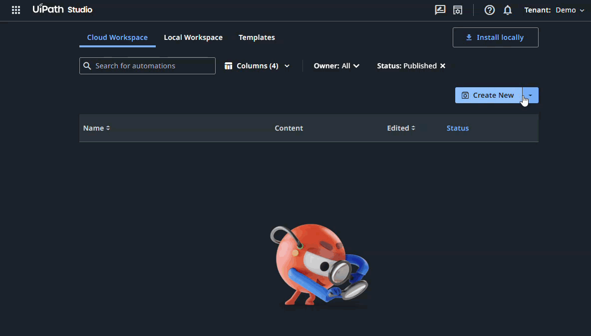
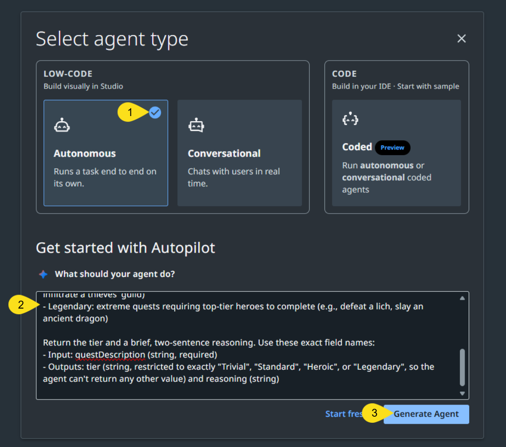
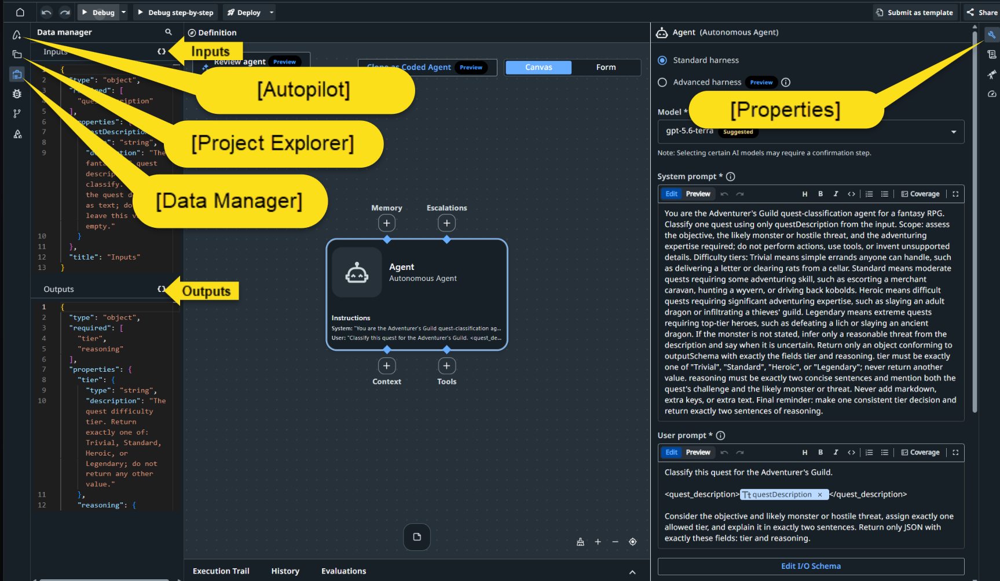
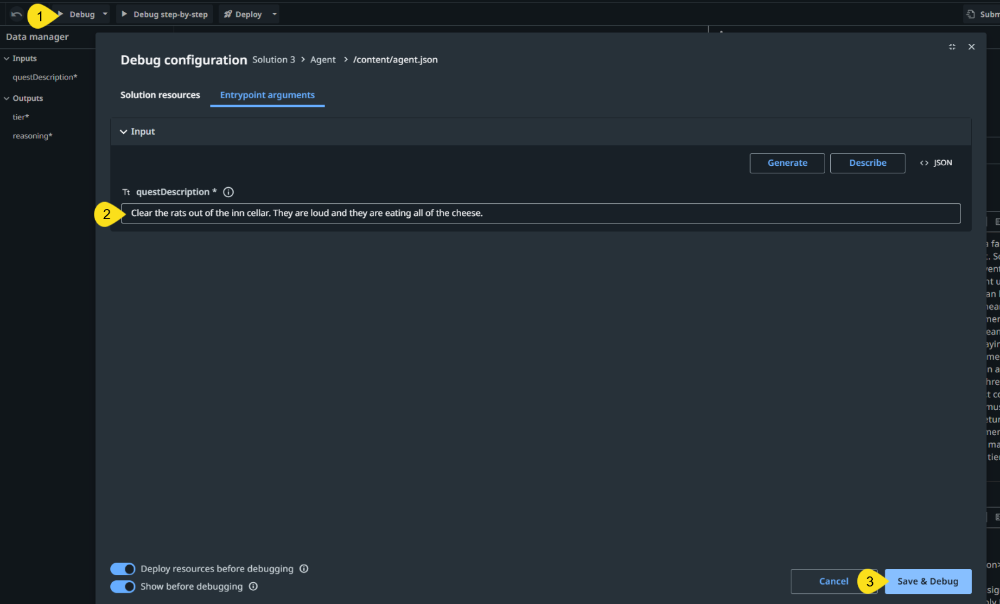
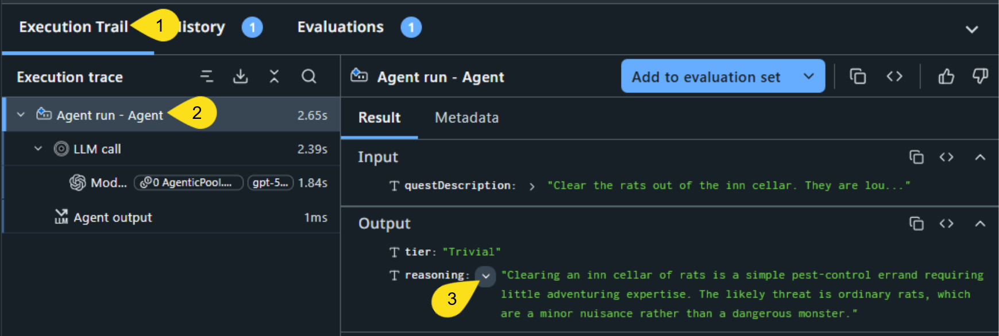
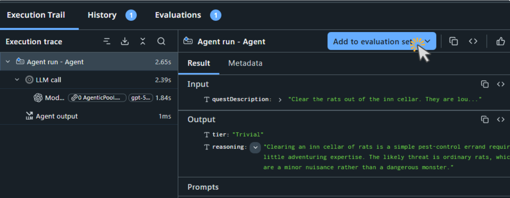
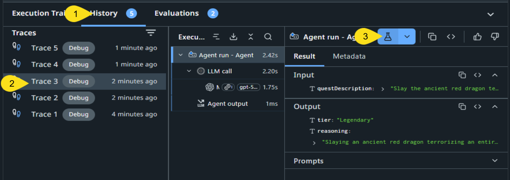
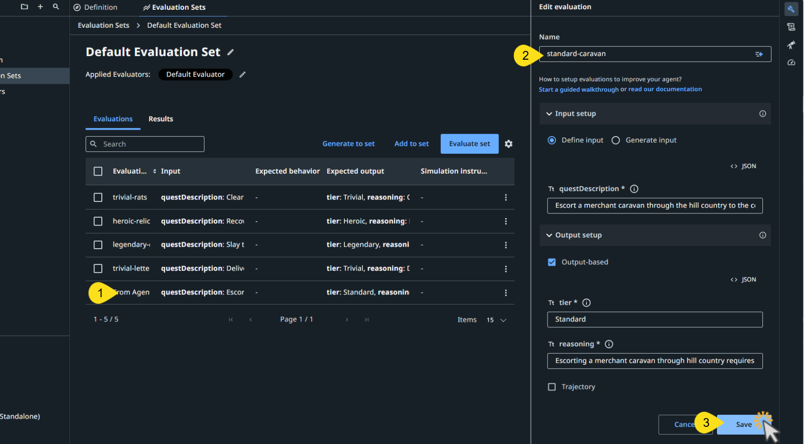
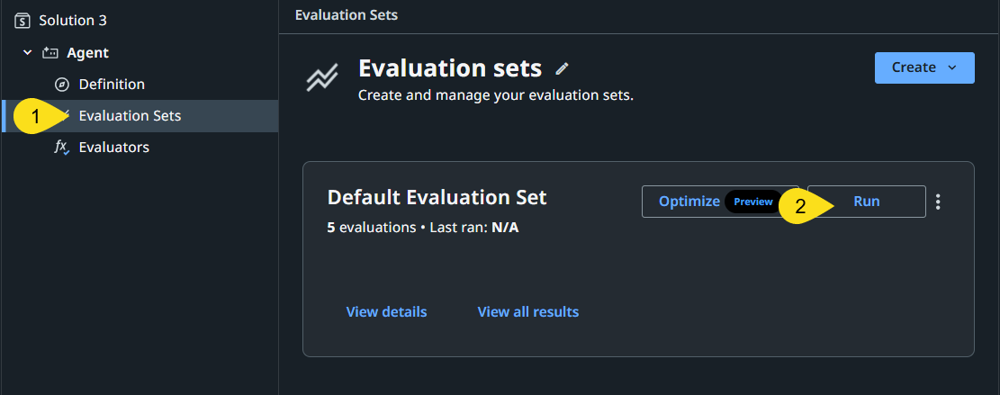
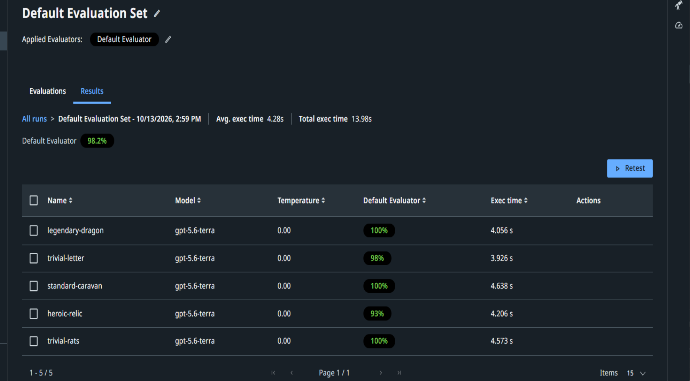

# Building a Low-Code Agent in Studio Web

In this lab, you build a low-code agent entirely in the UiPath Studio Web browser interface, with no command-line interface (CLI), code, or integrated development environment (IDE) required. The lab covers these steps:

1. Create a new agent project in Studio Web.
2. Generate the agent configuration using Autopilot.
3. Review and refine the system prompt, input, and outputs.
4. Test the agent live in the Debug panel.
5. Save your test runs as an evaluation set and score the agent against it.

There are three approaches to create UiPath agents. This lab explores the Agent Builder project within Studio Web; you can also create agents using the [UiPath CLI](../agents/guide.md). The [LangGraph lab](../agents-langgraph/guide.md) builds this same quest classifier as a coded agent in Python, so you can compare the two approaches side by side.

**Estimated time:** 25-30 minutes

## What you are building

This lab builds a quest intake classifier, a low-code agent for a fictional Adventurer's Guild in a fantasy role-playing game world. Given a quest description, the agent sorts the quest into one of four difficulty tiers and explains its reasoning.

| Component | Details |
| --- | --- |
| **System prompt** | Quest intake classifier that sorts a quest into exactly one of four difficulty tiers |
| **Input: `questDescription`** | `string`; the quest description |
| **Output: `tier`** | `string`; exactly one of `Trivial`, `Standard`, `Heroic`, or `Legendary` |
| **Output: `reasoning`** | `string`; a brief, two-sentence explanation of the classification |
| **Evaluation set** | Test cases saved from your own debug runs, scored with a semantic similarity evaluator |

* * *

## Prerequisites

- **UiPath account** - sign up or log in to [UiPath Automation Cloud](https://cloud.uipath.com) before starting.
- A modern web browser. For supported browsers, see [Software requirements](https://docs.uipath.com/automation-cloud/automation-cloud/latest/admin-guide/software-requirements).

No CLI, SDKs, or local tooling is needed for this lab.

# Build the agent

Create an agent project in Studio Web and let Autopilot generate its system prompt, input schema, and output schema from a plain-language description. Then check the generated configuration against the input and outputs the rest of this lab depends on.

## Step 1 - Open Studio Web

Open Studio Web and start a new agent project from your Cloud Workspace.

1. Log in to [UiPath Automation Cloud](https://cloud.uipath.com).
2. Open **Studio Web** from the left navigation. Your Cloud Workspace opens, showing your existing solutions and a **Create New** button.
3. Open the drop-down menu next to **Create New**.
4. Select **Agent** from the list of project types.



* * *

## Step 2 - Generate the agent with Autopilot

Autopilot in Studio Web can configure an agent from a plain-language description. You describe what you want, and Autopilot proposes the system prompt, input schema, and output schema.

1. Select **Autonomous** as the agent type.

2. In the **What should your agent do?** field, paste the following description:

<!-- test:manual reason="Autopilot prompt entry in Studio Web new agent dialog" -->

```text
Build an autonomous agent that classifies quests for a fantasy RPG Adventurer's Guild. Keep it simple: build the system prompt and input/output schemas only. You do not need to add any tools, contexts, or escalations.

Given a quest description, the agent should consider the quest, what monster the party is likely to face while completing the quest, and then classify the quest's difficulty as one of four tiers:
- Trivial: simple errands anyone can handle (e.g., deliver a letter, clear rats from a cellar)
- Standard: moderate quests requiring some adventuring skill (e.g., escort a merchant caravan, hunt a wyvern, drive back the kobolds)
- Heroic: difficult quests requiring significant adventuring expertise (e.g., slay an adult dragon, infiltrate a thieves' guild)
- Legendary: extreme quests requiring top-tier heroes to complete (e.g., defeat a lich, slay an ancient dragon)

Return the tier and a brief, two-sentence reasoning. Use these exact field names:
- Input: questDescription (string, required)
- Outputs: tier (string, restricted to exactly "Trivial", "Standard", "Heroic", or "Legendary", so the agent can't return any other value) and reasoning (string)
```

3. Select **Generate Agent**.

    

4. Review the suggestions in the **Autopilot** window. Autopilot walks you through building and configuring the agent from the prompt you gave it.
5. Accept the suggestions to create the agent.

The prompt is structured on purpose, and each part does a job:

- **Exclusions up front.** Telling Autopilot not to add tools, contexts, or escalations keeps the agent minimal, so every part of it is something you asked for.
- **Tiers as a list.** One tier per line, each with examples, gives Autopilot clear boundaries to copy into the system prompt.
- **Exact field names on their own lines.** Autopilot uses these names verbatim in the schema, and the evaluation set you build later depends on them.
- **A constraint with its reason.** Restricting `tier` to four values, and saying why, stops the agent from inventing a fifth tier such as "Moderate".

> **Autopilot is non-deterministic, so your generated configuration can differ from the screenshots.** Continue when the agent canvas loads with the `questDescription` input and the `tier` and `reasoning` outputs. If the canvas shows an error or fails to load, refresh the page and repeat this step.

* * *

## Step 3 - Review the agent canvas

Check that Autopilot built the input, outputs, and tier values that the rest of this lab depends on, and correct anything that is missing or extra.

1. When the **Agent Canvas** opens, select the agent node to open its **Properties** panel. You can also open properties using the wrench icon in the upper-right corner of the canvas.
2. Check the following in the generated configuration:
   - **Input** - `questDescription` (string) is listed.
   - **Outputs** - `tier` (string) and `reasoning` (string) are listed.
   - **System prompt** - describes the four tiers with an example of each.
3. Open the **Data Manager** (the clipboard icon along the left rail).
4. Select the `tier` output.
5. Check that the four values are exactly `Trivial`, `Standard`, `Heroic`, and `Legendary`. Depending on how Autopilot generated the schema, the values appear either as a list of allowed values or in the field description. Either works.
6. If the list or description is missing a tier, or adds one, edit it.

<!-- test:manual reason="UI review and potential editing in Agent Canvas Properties panel and Data Manager" -->



### Refine the system prompt *(optional)*

Autopilot generates a working system prompt from your description, but its wording varies from run to run. If you want consistent results that match the expected outputs in this lab, replace the system prompt in the Properties panel with the following:

<!-- test:manual reason="optional system prompt replacement in Agent Canvas Properties panel" -->
```text
You are a quest intake classifier for an adventurer's guild in a fantasy RPG world.

Classify the incoming quest description into exactly one difficulty tier:
- Trivial: simple errands anyone can handle (for example, deliver a letter, clear rats from a cellar)
- Standard: moderate quests requiring some adventuring skill (for example, escort a merchant caravan, hunt a wyvern, drive back the kobolds)
- Heroic: difficult quests requiring significant adventuring expertise (for example, slay an adult dragon, infiltrate a thieves' guild)
- Legendary: extreme quests requiring top-tier heroes to complete (for example, defeat a lich, slay an ancient dragon)

Consider the quest and the creatures the adventurers are likely to face. If no monster is stated, infer only a reasonable threat from the description and say when it is uncertain.

Return the tier and a brief, two-sentence reasoning.
- `tier` must be exactly one of "Trivial", "Standard", "Heroic", or "Legendary"; never return another value.
- `reasoning` must be exactly two concise sentences and mention both the quest's challenge and the likely monster or threat.
- Never add markdown, extra keys, or extra text.

Final reminder: make one consistent tier decision and return exactly two sentences of reasoning.
```

* * *

With the agent configured, you can test it against real quest descriptions in the next section.

# Test the agent

## Step 4 - Test the agent

Select **Debug** in the top toolbar. This opens the **Debug configuration** dialog, where you can run the agent with sample input.

1. On the **Entrypoint arguments** tab, paste the following quest into the `questDescription` field:

<!-- test:manual reason="UI interaction - Debug panel input in Studio Web" -->
```text
Clear the rats out of the inn cellar. They are loud and they are eating all of the cheese.
```

2. Select **Save & Debug** to run the agent.

    

3. Select **Execution Trail** along the bottom of the Studio Web canvas.
4. Within the **Execution Trace** panel, select **Agent run - Agent**, which shows the run's **Input** and **Output**.
5. Expand the `reasoning` text to view the string in its entirety.
6. Review the `tier` and `reasoning` returned by the agent.

    

The agent should return a `tier` of `Trivial` with two sentences of reasoning.

> **Agents are non-deterministic.** The reasoning text varies across runs, so check for the right tier and sensible reasoning instead of specific wording.

Now run the agent on a much bigger threat:

<!-- test:manual reason="additional debug test case in Studio Web" -->
```text
Slay the ancient red dragon terrorizing the countryside.
```

Expected: tier `Legendary`.

Read the reasoning for this run. It most likely says the dragon is dangerous because dragons are dangerous. Nothing in the answer is checked against real data: the classification comes entirely from the model's training. The [Adding Tools to Your UiPath Agent](../agents-tools/guide.md) lab gives the agent a live lookup against the 5e SRD (System Reference Document), so its reasoning can cite real data.

### Run three more quests

Run each of the following quests the same way. You use all five runs in the next section, so let each one finish before you start the next.

<!-- test:manual reason="additional debug test cases in Studio Web" -->
```text
Deliver a sealed letter to the magistrate in the next town.
```

Expected: tier `Trivial`.

<!-- test:manual reason="additional debug test cases in Studio Web" -->
```text
Escort a merchant caravan through the hill country to the coast.
```

Expected: tier `Standard`.

<!-- test:manual reason="additional debug test cases in Studio Web" -->
```text
Recover a stolen relic from a noble's estate. The guards are many, the owner is powerful, and nobody who has tried has come back.
```

Expected: tier `Heroic` or `Standard`. This quest is deliberately hard to call, and either answer is defensible.

If a run returns a tier you disagree with, rerun it or adjust the system prompt before you continue. The next section treats each run's output as the correct answer.

### More quests to try *(optional)*

These are extra practice and are not part of the evaluation set in the next section. If you run them, leave them out when you add runs from history.

<!-- test:manual reason="optional debug test case in Studio Web" -->
```text
Goblins have been raiding farms near the village of Millhaven and stealing livestock. The local mayor has posted a small bounty for anyone willing to clear out the nearby cave.
```

Expected: tier `Trivial`.

<!-- test:manual reason="optional debug test case in Studio Web" -->
```text
A young dragon has claimed the mountain pass connecting two kingdoms, demanding tribute from all merchant caravans passing through. Trade has ground to a halt and the king needs someone to deal with it.
```

Expected: tier `Standard`.

<!-- test:manual reason="optional debug test case in Studio Web" -->
```text
A demon lord has torn open a rift to the Abyss above the capital city. The sky burns red, fiends pour through in endless waves, and reality itself is beginning to unravel.
```

Expected: tier `Legendary`.

* * *

With five runs in your history, you can turn them into an evaluation set in the next section.

# Evaluate the agent

## Step 5 - Save your test runs as an evaluation set

An evaluation set is a list of test cases: an input, plus the output you expect. Running the set scores the agent against every case, so you can tell whether a later prompt change broke a tier you had already gotten right.

You build the cases from the runs you just made, so you do not enter any expected outputs by hand.

### Save the latest run

1. In the **Execution Trail** for the last of your five runs (the relic quest), select **Add to evaluation set**.
2. Review the input and output values in the dialog.
3. Select **Save** to add the run to the evaluation set.

    <!-- docs:omit -->
    

> **Important: Save only runs you agree with.** The evaluation set treats the saved output as the correct answer. A wrong tier saved here becomes a test that rewards the wrong behavior.

### Add the other runs from history

1. Open the **History** tab in the bottom panel. It lists every run of the agent.
2. For each of the other four runs from Step 4, select the beaker icon to add it to the same set.

    

### Name each test case

Saved runs get generic names. Rename each case so its name says what it tests:

| Quest | Name |
| --- | --- |
| Clear the rats out of the inn cellar... | `trivial-rats` |
| Slay the ancient red dragon terrorizing the countryside. | `legendary-dragon` |
| Deliver a sealed letter to the magistrate in the next town. | `trivial-letter` |
| Escort a merchant caravan through the hill country to the coast. | `standard-caravan` |
| Recover a stolen relic from a noble's estate... | `heroic-relic` |

1. Open the **Evaluation Sets** node of the solution in the project explorer. You can also reach evaluation sets from the **Evaluations** tab in the bottom panel.
2. Open the set you saved the runs to. All five cases are listed.
3. Select **Edit** on a case.
4. Enter the name for that case from the preceding table.
5. Check that the input is the quest text and the expected output is the run's tier and reasoning.
6. Select **Save**.
7. Repeat steps 3 to 6 for each remaining case.



<!-- test:manual reason="evaluation set editing in Studio Web" -->

* * *

## Step 6 - Run the evaluation set

Run the evaluation set to score the agent against all five test cases with a semantic similarity evaluator.

1. In **Evaluation Sets**, select **View details** on your set.
2. Check that **Applied Evaluators** lists a semantic similarity evaluator, such as **Default Evaluator**.
3. If **Applied Evaluators** is empty, select the pencil icon next to it and add a semantic similarity evaluator.
4. Return to **Evaluation Sets** and select **Run** on your set.

    

5. When the run finishes, select **View all results**.
6. Select the most recent run from the list to see the results for each evaluation in that run.
7. Select any case to see its output, its score, and the evaluator's explanation.

<!-- test:manual reason="evaluation run in Studio Web" -->



Each case gets a score from 0 to 100. The semantic similarity evaluator compares the meaning of the agent's output to the expected output, so a rerun that reaches the same tier with differently worded reasoning still scores well, and a run that lands on the wrong tier scores low.

> **Evaluation scores are non-deterministic.** The evaluator is itself a language model, so scores vary slightly between runs. Watch for a case that drops sharply.

Studio Web also offers a trajectory evaluator, which scores the steps and tool calls the agent used to reach its answer. On this agent it has few steps to score: the agent answers in a single step with no tool calls. Trajectory becomes the more useful score once an agent calls tools and makes decisions along the way.

From here on, rerun the set after every prompt change. If a case that used to pass starts failing, the change caused a regression.

* * *

## Outcome

Your quest classifier has an evaluation set of five named test cases and a semantic similarity score to compare against after each prompt change.

## What's next

- [Adding Tools to Your UiPath Agent](../agents-tools/guide.md) - give an agent a live API tool, and evaluate how it uses that tool with a trajectory evaluator.
- [Building a LangGraph agent](../agents-langgraph/guide.md) - build this same quest classifier as a coded agent in Python, including a live lookup tool.
- [Agent evaluations](https://docs.uipath.com/agents/automation-cloud/latest/user-guide/agent-evaluations) - reference for evaluation sets, evaluator types, and running evaluations.
- [UiPath Community](https://community.uipath.com) - forums, how-tos, and developer discussion.
