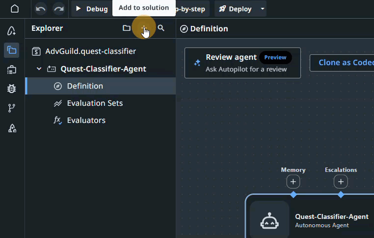
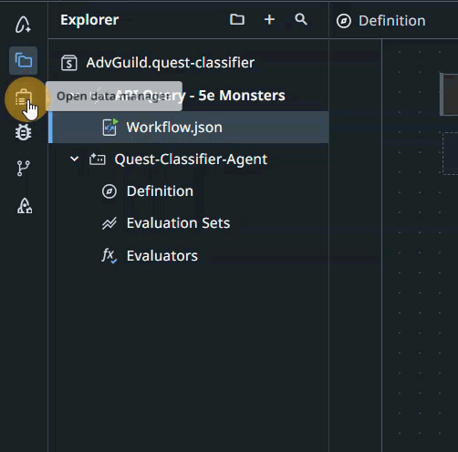
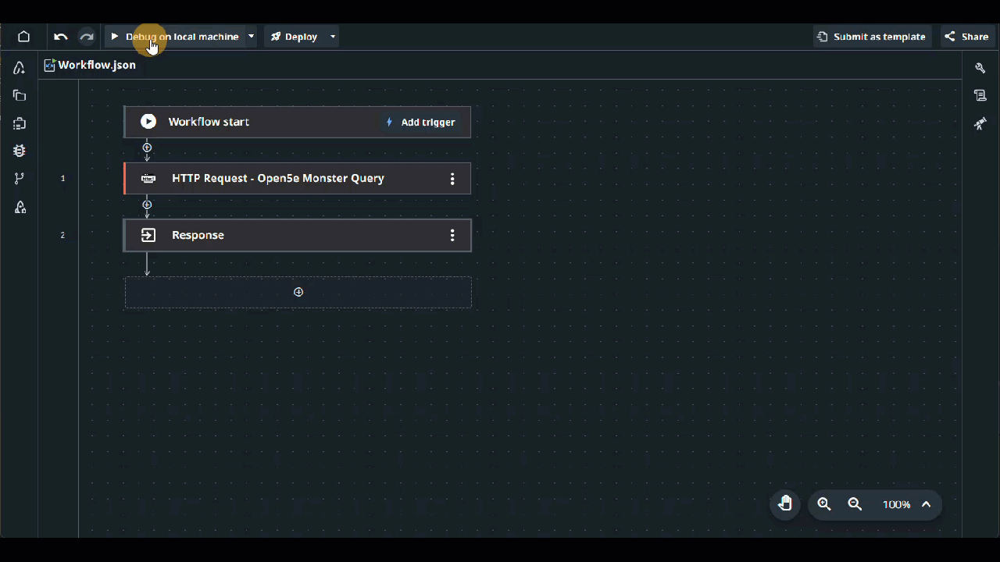
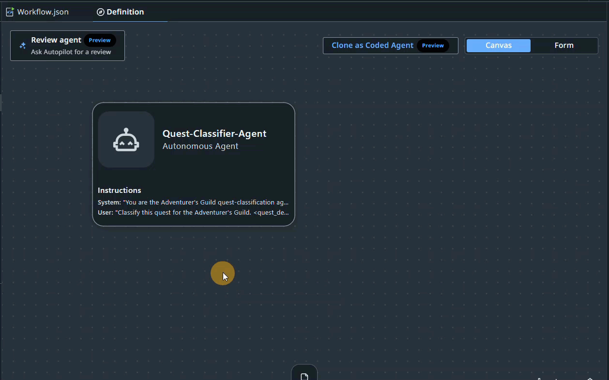
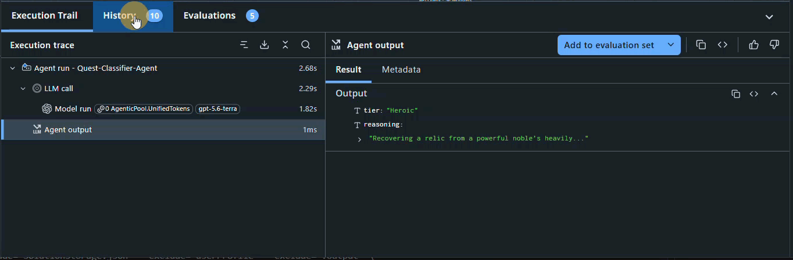
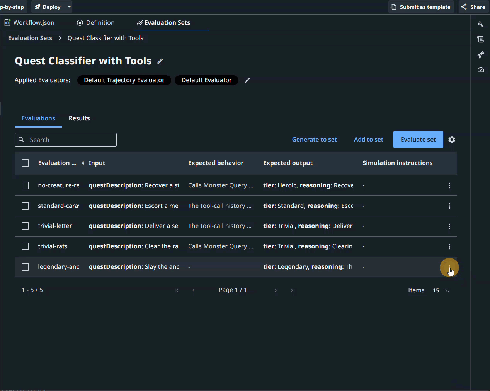
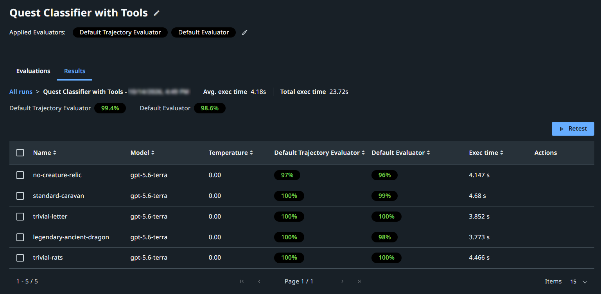

# Adding Tools to Your UiPath Agent

This lab extends the quest classifier you built in [Building a Low-Code Agent in Studio Web](../agents-lowcode/guide.md) - adding an API workflow as a tool for the agent. The tool enables the agent to look up creature data from the 5e SRD (System Reference Document), providing real challenge rating data that the agent can use and cite in its reasoning.

The starting agent sorts a quest into one of four difficulty tiers, but its reasoning comes entirely from the model's training: ask it about an ancient red dragon and it answers Legendary because dragons are dangerous. With the tool added, the agent decides at runtime whether a quest needs a lookup: a quest that names a creature gets one, and a quest to deliver a letter does not.

In this lab, you:

1. Build a Monster Query API workflow that searches the 5e SRD.
2. Connect it to your quest classifier as a tool.
3. Replace the system prompt so the agent knows when to call the tool and how to use what it returns.
4. Test the agent on quests that do and do not need a lookup.
5. Evaluate how the agent uses the tool with a tool-aware evaluation set.

This lab uses an API workflow as the tool. An agent can also call:

- RPA workflows
- Functions
- Integration Service connectors, for systems such as Slack, Outlook, or an enterprise resource planning (ERP) system
- Document understanding
- Maestro cases and flows
- DeepRAG
- Web searches
- Model Context Protocol (MCP) servers
- Other agents, including remote agent-to-agent calls

**Estimated time:** 40-50 minutes

## What you are building

| Component | Details |
| --- | --- |
| **API Workflow** | Accepts `searchName` (string), calls the Open5e 5e SRD API, returns a `monsterResults` array |
| **Tool: Monster Query** | The API Workflow, connected to the agent. Called only when a quest names or strongly implies a specific creature |
| **Agent input: `questDescription`** | `string`; unchanged from the low-code lab |
| **Agent output: `tier`** | `string`; unchanged: exactly one of `Trivial`, `Standard`, `Heroic`, or `Legendary`. When the tool returns a challenge rating, the tier follows from it |
| **Agent output: `reasoning`** | `string`; unchanged, but now cites the challenge rating whenever the tool returned one |
| **Evaluation set** | A tool-aware set, scored by both a semantic similarity evaluator and a trajectory evaluator |

* * *

## Prerequisites

- **Studio Web** - runs in your browser; no desktop installation required. Open [Studio Web](https://cloud.uipath.com) in Chrome, Edge, or Firefox before starting.
- **UiPath account** - sign up or log in to [UiPath Automation Cloud](https://cloud.uipath.com) before starting.
- **A quest classifier agent in Studio Web** - this lab builds on the agent from [Building a Low-Code Agent in Studio Web](../agents-lowcode/guide.md), including its evaluation set. If you completed that lab, your agent is already in your workspace, and you need nothing else: the rest of this lab runs entirely in the browser.

### If you need the starter agent

If you are starting fresh and did not complete the earlier lab, you can deploy the quest classifier agent and start there. The starter includes the agent and the evaluation set from the prior lab.

To restore the starter sample, you need the UiPath command-line interface (CLI). To install the CLI, refer to [Environment set up](https://docs.uipath.com/getting-started/other/latest/developer-guide/environment-setup) and complete Step 1 (Install the UiPath CLI and Tools) and Step 4 (Authenticate to UiPath); you do not need the UiPath skills or the VS Code extension steps to complete this lab.

<!-- test:prereq name="uip" version=">=1.200" ignore-for-docs="true" -->
```bash
uip --version
```

Use these CLI commands to deploy the starter:

<!-- test:manual reason="requires git clone and uip login before starter upload" -->
```bash
git clone https://github.com/cliff-simpkins/UiPath-Workshops.git
cd UiPath-Workshops/starters/advguild.quest-classifier
uip login
uip solution upload .
```

Open [Studio Web](https://cloud.uipath.com) and confirm **AdvGuild.quest-classifier** appears in your workspace before beginning Step 1.

# Build the API workflow

## Step 1 - Build the Monster Query API workflow

An API workflow is a lightweight workflow published as an API endpoint. You build a simple one that wraps the [Open5e monster search](https://open5e.com/) for the 5e System Reference Document (SRD): it takes a string input, does an HTTP request, and returns an array of monster entries, each a JSON string that the agent parses. Because it lives in the same solution as your agent, the agent builder lists it as a tool your agent can call.

This step has five tasks, plus a property reference for the HTTP Request activity; budget 10–15 minutes to complete it.

### Create a new API workflow project

1. Open your quest classifier solution in Studio Web: the one from the low-code lab, or **AdvGuild.quest-classifier** if you deployed the starter.
2. In the Project Explorer pane, select **Add to solution** (`+` icon) and choose **API Workflow** under **Task automation**.
3. Rename the project to `API Query - 5e Monsters` and select the **Apply** check icon. You can also rename the project by opening the context menu in the project explorer and selecting **Rename**.

<!-- docs:omit -->


### Configure inputs and outputs

1. Select the **Data Manager** (clipboard icon along the left rail) to access the data variables for the workflow.
2. Add one input argument to the workflow:

   | Name | Type | Required | Description |
   | --- | --- | --- | --- |
   | `searchName` | String | Yes | The monster name or partial name to search for |

3. Add one output argument:

   | Name | Type | Required | Description |
   | --- | --- | --- | --- |
   | `monsterResults` | Array[String] | Yes | Monster result list |



### Add the HTTP request

1. In the workflow canvas, select **+** between activities to open the activity menu. Select **HTTP**. The activity appears on the canvas as **HTTP Request**.
2. Open the activity context menu and select **Rename**.
3. Enter `HTTP Request - Open5e Monster Query` as the name.
4. In the **Properties** pane, confirm **Authentication** is **Manual authentication** and **Method** is **GET**. Both are the defaults on a new activity, so there is normally nothing to change.
5. Set **URL** to `https://api.open5e.com/v2/creatures/`.
6. Rename the activity output to `searchResults`.


#### Set the query parameters

1. Open the **Query parameters** property. It opens a **Dictionary editor** with Key and Value columns.
2. Add the following fields:

   | Key               | Value                                                              |
   | ----------------- | ------------------------------------------------------------------ |
   | `name__icontains` | the `$input.searchName` input argument - see the note that follows |
   | `document__key`   | `srd-2024`                                                         |
   | `limit`           | `10`                                                               |
   | `fields`          | `key,name,type,size,challenge_rating,alignment`                    |

> **Important:** Use the Expression Editor to enter `$input.searchName`, instead of entering it as text. After you select **Save** in the expression editor, the value renders as a chip. Entered as plain text, `$input.searchName` goes to the API as a literal string and returns zero results while every node stays green.

What each parameter does:

- `name__icontains`: case-insensitive partial match; `dragon` returns "Adult Red Dragon", "Young Blue Dragon", and others
- `document__key: srd-2024`: filters to the official 5e SRD (the 2024 edition); without it, results include every publisher in the database, third-party content included
- `limit: 10`: caps candidates at 10; enough for the agent to reason over without flooding its context
- `fields`: limits the response to only the fields the agent needs; the full v2 creature object is much larger and would waste token budget

> **Important: Open5e ignores query parameters it does not recognize, and returns HTTP 200 anyway.** Misspell `document__key`, or use the v1 spelling `document__slug`, and the call returns creatures from every publisher instead of the SRD. A `goblin` search returns 5 results with the filter applied and 29 without it.


### HTTP Request property reference

The activity exposes the standard HTTP building blocks. You configure most of them for every API you call, and skip some for public APIs like this one:

- **Authentication**: pre-built options for OAuth 2.0, API key, and Basic auth. Set to "Manual authentication" here because Open5e requires none. For authenticated APIs, choose the appropriate option and supply credentials.
- **Headers**: key/value pairs sent with every request. Common uses: `Authorization: Bearer <your-access-token>` for token-based APIs, `Accept: application/json` to control response format, and API versioning headers.
- **Body**: used with POST, PUT, and PATCH requests to send JSON, form data, or raw content. Not applicable for GET requests, which carry parameters in the URL via query parameters.
- **Query parameters**: key/value pairs appended to the URL. To reference a workflow argument, use the Expression Editor to enter `$input.<name>`; after you save the expression, the field displays it as a chip. See [configuring activities](https://docs.uipath.com/studio-web/automation-cloud/latest/user-guide/configuring-activities) for more on variables and expressions in Studio Web.
- **Output (renamed to `searchResults`)**: receives the full HTTP response including status code, headers, and body. Renaming from the default keeps the Response expression readable.

### Add the response

1. In the workflow canvas, select **+** after the HTTP Request and select **Response**.

   The Response activity defines what the API Workflow returns to its caller (in this case, what the agent's tool receives when it invokes the workflow). The response body becomes the tool output the agent reasons over.

2. Set the response body to:

   ```json
   {
     "monsterResults": $context.outputs.searchResults.content.results
   }
   ```

`$context.outputs` contains every named output from the activities in this workflow. `searchResults` is the output variable you renamed on the HTTP Request activity; `.content.results` navigates into the response envelope that Open5e wraps its data in, down to the array of monster entries. For more information, see [the UiPath documentation on using JavaScript to access workflow data](https://docs.uipath.com/studio-web/automation-cloud/latest/user-guide/managing-api-workflows#accessing-data-using-javascript).

<!-- docs:omit -->


### Test the workflow

1. Select **Debug** from the toolbar.
2. In the input panel, set `searchName` to `rat` and run the workflow.

The response includes a `monsterResults` array of up to 10 entries. Each entry has:

- `key`
- `name`
- `alignment`
- `challenge_rating`
- Nested `type` and `size` objects

Searching `rat` returns exactly seven results, all with `srd-2024_` keys, including:

- Giant Rat (`srd-2024_giant-rat`, challenge rating 0.125)
- Swarm of Rats (`srd-2024_swarm-of-rats`, challenge rating 0.25)
- Triceratops (`srd-2024_triceratops`, challenge rating 5)
- Two pirates, because `name__icontains` matches the search text anywhere in the name

Any other count means a parameter is misspelled or not bound to the variable; fix it before you continue.



* * *

With the workflow returning results, switch back to the agent in the same solution to connect it as a tool.

# Connect to your agent

## Step 2 - Open the quest classifier agent

Your solution now holds two projects: the quest classifier agent and the `API Query - 5e Monsters` workflow you just built. In the project explorer, select the agent project to open it in the agent builder. If you deployed the starter, the agent project is **Quest-Classifier-Agent**.

Review the agent's current configuration before making changes:

- **Project Input:** `questDescription` (string).
- **Project Outputs:** `tier` (string, one of four values) and `reasoning` (string).
- **System prompt:** describes the four tiers. If Autopilot wrote it, or you deployed the starter, it most likely also tells the agent to classify from the description alone and not to use tools.
- **Evaluation set:** the five cases from the low-code lab. You rerun them in Step 6.

In this lab, you do not change the input or the outputs. You add a tool, and you replace the system prompt so the agent knows how to use it.

* * *

## Step 3 - Connect the API workflow as a tool

Register the `API Query - 5e Monsters` workflow as a tool on the agent, then give it the name and description the agent reads at runtime.

### Add the tool

Make sure you are on the **Canvas** view: use the **Canvas / Form** toggle at the top of the agent builder. The **+** button under Tools is only visible in Canvas view.

1. On the agent canvas, select **+** under **Tools**.
2. In the **Choose tool** panel, select **API workflow** under **Toolbox**.
3. Under **Available resources**, select `API Query - 5e Monsters`, the workflow you added to this solution in Step 1. You can also filter the list with the **Search API workflows** box.

> **Don't see the workflow?** Check the project explorer: `API Query - 5e Monsters` should be listed in the same solution as the agent. If you created it as a separate solution instead, publish it first (**Publish** > **For me**), and it appears here under its project name.

Keeping the tool in the agent's solution needs no publish step, and the agent's evaluations call it like any other tool. In your own projects, give a tool its own solution and publish it when more than one agent needs to call it.



### Configure the tool description

Give the tool a name and description. Write the description as an instruction to the agent:

- **Name:** `Monster Query`
- **Description:** `Searches the 5e SRD for monsters whose name contains the search text. Search with the most specific creature name the quest gives; a general term such as a creature type can return many matches and miss the one you need. Returns up to 10 candidates with key, name, type, size, challenge rating, and alignment. Call this tool when a quest names or strongly implies a specific creature, to look up its challenge rating.`
- **searchName** (if blank)**:** `The monster name or partial name to search for`

> **The description drives tool selection.** The agent reads this description, not the tool name, to decide when and how to call the tool.

The "most specific creature name" instruction matters for this API. A search for `dragon` matches 43 creatures, and the 10 that come back are all adult dragons, so a quest about an ancient red dragon never sees the right candidate. A search for `ancient red dragon` returns exactly one result.

> **An API workflow is one kind of tool.** The steps to connect and describe a tool are the same for every type, and an agent can also call:
>
> - RPA workflows
> - Functions
> - Integration Service connectors, for systems such as Slack, Outlook, or an enterprise resource planning (ERP) system
> - Document understanding
> - Maestro cases and flows
> - DeepRAG
> - Web searches
> - Model Context Protocol (MCP) servers
> - Other agents, including remote agent-to-agent calls

* * *

## Step 4 - Replace the system prompt

The current system prompt was written for an agent with no tools. Replace it in full rather than adding to it: if it tells the agent not to use tools, an appended instruction to call Monster Query contradicts it, and the agent may never make the call.

To open the **Properties** panel, select the agent on the canvas or select the wrench icon in the upper-right corner. Replace the system prompt with:

<!-- test:manual reason="system prompt replacement in Agent Canvas Properties panel" -->
```text
You are a quest intake classifier for an adventurer's guild in a fantasy RPG world.

Classify the incoming quest description into exactly one difficulty tier:
- Trivial: simple errands anyone can handle (for example, deliver a letter, clear rats from a cellar)
- Standard: moderate quests requiring some adventuring skill (for example, escort a merchant caravan, hunt a wyvern)
- Heroic: difficult quests requiring significant adventuring expertise (for example, slay an adult dragon, infiltrate a thieves' guild)
- Legendary: extreme quests requiring top-tier heroes to complete (for example, defeat a lich, slay an ancient dragon)

Using the Monster Query tool:
- Call Monster Query when the quest description names or strongly implies a specific creature the adventurers must face.
- Creatures include people the party may have to fight, such as bandits or guards.
- Search with the most specific creature name the quest gives.
- Only search for creatures in the quest itself, never for a creature you are using as a comparison or reference point.
- If a search returns no results, you may try one shorter or more general name. Stop after three searches in total.
- If the tool returns more than one result, pick the best fit: name match first, then number (a group of rats fits "Swarm of Rats" better than "Rat"), then type.

Using the challenge rating:
- When the tool returns a challenge_rating, use this map to set the minimum tier: Trivial 0-5, Standard 6-12, Heroic 13-20, Legendary 21 and above.
- Raise the tier above that minimum when the quest describes many opponents, a powerful leader or patron, or a history of failed attempts. One creature's challenge rating is not the difficulty of the whole quest.
- Cite the exact challenge rating in your reasoning.
- Never guess or invent a challenge rating. Only cite one the tool actually returned.
- If you do not call the tool, or it returns nothing that fits, classify from the quest description alone.

Return the tier and a brief, two-sentence reasoning.
```

The challenge rating map sets the minimum tier, and the quest's context can raise it:

| Creature | Challenge rating | Minimum tier |
| --- | --- | --- |
| Guard | 0.125 | Trivial |
| Swarm of Rats | 0.25 | Trivial |
| Wyvern | 6 | Standard |
| Adult Red Dragon | 17 | Heroic |
| Ancient Red Dragon | 24 | Legendary |

A quest with guards starts at Trivial, but one that says the guards are many and nobody has come back raises the tier.

> **Keep the examples in the prompt consistent with the map.** An example can sit above its creature's minimum tier, but never below it: listing "hunt a wyvern" as a Trivial example contradicts the map, because a wyvern's minimum is Standard. A contradiction like that makes the agent's tier unpredictable.

The input and output schemas do not change. The challenge rating goes into the `reasoning` text.

> **Agents are non-deterministic.** Your agent's search terms and reasoning vary from run to run. A correct run calls the tool when a quest names a creature, skips it when one does not, and cites only challenge ratings the tool returned.

* * *

With the tool connected and the system prompt replaced, you can test the agent in the next section.

# Test end-to-end

## Step 5 - Test end-to-end

1. Select **Debug** from the toolbar at the top of the agent builder.
2. Enter the following quest:

<!-- test:manual reason="debug test case in Studio Web" -->
```text
Slay the ancient red dragon terrorizing the countryside.
```

3. Select **Save & Debug**.

Watch the **Execution Trail** at the bottom of the agent builder. For this quest, expect:

1. The agent calls **Monster Query** with a search term for the ancient red dragon.
2. The tool returns one result: Ancient Red Dragon (`srd-2024_ancient-red-dragon`), challenge rating 24.
3. The agent returns a `tier` of `Legendary`, and its `reasoning` cites the challenge rating of 24.


Select the **HTTP Request - Open5e Monster Query** span to see the request the tool sent: the `v2/creatures/` URL, the search term the agent chose in `name__icontains`, and the `document__key` and `fields` values you configured in Step 1.


Now run two more quests, letting each finish before you start the next:

<!-- test:manual reason="debug test case in Studio Web" -->
```text
Clear the rats out of the inn cellar. They are loud and they are eating all of the cheese.
```

Expected: one Monster Query call for rats, Swarm of Rats (challenge rating 0.25), tier `Trivial`.

<!-- test:manual reason="debug test case in Studio Web" -->
```text
Deliver a sealed letter to the magistrate in the next town.
```

Expected: no Monster Query call, because the quest names no creature, and tier `Trivial`.

The letter run matters as much as the dragon run. An agent that calls the tool on every quest wastes an API call and tokens each time, and an agent that never calls it is back to guessing. Step 7 measures both.

* * *

With the agent calling its tool only when it should, you can evaluate it in the next section.

# Evaluate agent trajectory

## Step 6 - Rerun your existing evaluation set

Your agent already has an evaluation set: the five cases from the low-code lab. Before you build anything new, rerun it to check what the change did to behavior you had already accepted.

1. In the project explorer, open the agent's **Evaluation Sets** node, and find the set from the low-code lab.
2. Select **Run** for the evaluation set.
3. When the run finishes, select **View all results**, then select the most recent run.

<!-- test:manual reason="evaluation run in Studio Web" -->

Expect the returned tiers to hold, and expect the semantic similarity scores to barely move. For example, the rats and dragon cases can drop from 100% to 98%.

Their saved outputs come from the agent before it had a tool, so the expected reasoning does not cite a challenge rating and the new reasoning does. The meaning is close enough that semantic similarity hardly registers the change. The exception is `heroic-relic`, which can score lower: its new reasoning cites a guard's challenge rating and drops details the saved answer included, such as possible magical defenses.

The agent now reaches its answer a different way: it calls a tool, then sets the tier from the challenge rating it gets back. A semantic similarity score compares answers, so it can't see that change. To check how the agent got to its answer, you need a trajectory evaluator, which the next step adds in a new set that describes the new behavior.

> **Evaluation scores are non-deterministic.** The evaluator is itself a language model, so scores vary between runs. A two-point drop like this one is within that normal variation.

* * *

## Step 7 - Build a tool-aware evaluation set

The new set checks two things: what the agent answered, and how it got there.

- **Semantic similarity** - compares the agent's output to the expected output by meaning, not exact wording.
- **Trajectory** - scores how the agent reached its answer from its tool calls: whether it called the tool, what it searched for, and in what order. It tells you whether the tool description and system prompt are doing their job.

### Capture the remaining runs

You already have three runs from Step 5. In the **Debug** panel, run the agent on two more quests:

<!-- test:manual reason="additional debug test cases in Studio Web" -->
```text
Escort a merchant caravan through the hill country to the coast.
```

<!-- test:manual reason="additional debug test cases in Studio Web" -->
```text
Recover a stolen relic from a noble's estate. The guards are many, the owner is powerful, and nobody who has tried has come back.
```

Neither quest names a monster to look up. The relic quest is the harder test: the guards are people the party may have to fight, so one lookup for guards is reasonable, but the relic and its owner aren't threats to search for. An agent that over-uses its tool searches for those too.

### Create a new evaluation set and add the debug runs

1. In **Evaluation Sets**, create a new evaluation set and name it `Quest Classifier with Tools`.
2. Return to the agent's **Definition** to access the agent's trace history.
3. Open the **History** tab in the bottom panel, and select the trace for the run that you want to add.
4. Select **Add to evaluation set** and choose the new set from the drop-down.
5. In the **Add Trace** dialog, review the inputs and outputs and select **Save** to save the trace as an evaluation.
6. Repeat this process for the other four runs from Steps 5 and 7 - adding each of them to the same set.

> **Important: Save only runs you agree with.** The evaluation set treats each saved output as the correct answer. Check that every run reached the expected tier and called the tool only when it should have.



### Describe the expected behavior

The trajectory evaluator scores each run against a written description of what the agent should do. Give each case a name and an expected behavior from this table:

| Name                       | Expected behavior                                                                                                                                    |
| -------------------------- | ---------------------------------------------------------------------------------------------------------------------------------------------------- |
| `legendary-ancient-dragon` | Calls Monster Query before answering, with a search term naming the ancient red dragon rather than a general term such as "dragon".                  |
| `trivial-rats`             | Calls Monster Query before answering, with a search term for rats, such as "rat", "rats", or "swarm of rats".                                        |
| `trivial-letter`           | The tool-call history should be empty. No creature is named, so the agent should not call Monster Query, and an empty history is the correct result. |
| `standard-caravan`         | The tool-call history should be empty. No creature is named, so the agent should not call Monster Query, and an empty history is the correct result. |
| `no-creature-relic`        | Calls Monster Query only to look up the guards, or does not look up anything at all. Does not search for the relic or its owner.                     |

> **Describe tool use, not the answer.** The trajectory evaluator reads only the agent's tool-call history and never sees the final answer, so describe whether the agent calls a tool and what it searches for, and allow reasonable variations in search terms. When the agent shouldn't call a tool, say that an empty history is the correct result, or the evaluator reads it as missing evidence.

1. Open **Evaluation Sets** and select **View details** to open the new evaluation set you created.
2. For each case, select **Edit** to open its settings, and then:
   1. Rename the case to its name in the table.
   2. Select the **Trajectory** checkbox, if it is not already selected.
   3. Under **Agent tools**, leave **Simulate** off for Monster Query, so the tool makes real calls. The trajectory evaluator is less useful when tool calls are mocked.
   4. Paste the expected behavior into the **Behavior and output notes** field.
   5. Select **Save**.



<!-- test:manual reason="evaluation set editing in Studio Web" -->

### Attach both evaluators and run the set

1. In the new set, select the pencil icon next to **Applied Evaluators**.
2. Check that the list includes both a semantic similarity evaluator and a trajectory evaluator. If the project has no trajectory evaluator yet, create one from the same dialog.
3. Select **Evaluate set** to run all of the evaluations in the list.
4. When the run finishes, select the most recent run. Each case shows a semantic similarity score and a trajectory score, from 0 to 100.
5. Select any case to see the run, its scores, and each evaluator's explanation.

<!-- test:manual reason="evaluation run in Studio Web" -->



> **Important: A missing evaluator fails silently.** If you forget to attach the trajectory evaluator, the set still runs and shows only semantic similarity scores. If you see one score per case, revisit **Applied Evaluators**.

Expect high scores from both evaluators with these descriptions. In the run in the preceding screenshot, semantic similarity averaged 98.6% and trajectory averaged 99.4%.

Run the set more than once before you trust a number: the trajectory evaluator is also a language model, and in testing, the same case with the same description scored 45% on one run and 75% on the next. To see how the evaluator scored a case, open it and read its **justification**.

> **You may see a justification mention a redundant first call that returned empty.** The evaluator's view of the run lists each tool call twice, even though the agent called the tool once (check the **Execution Trail** to confirm). Until that's fixed, avoid expected behaviors that limit the number of tool calls.

A low trajectory score with a high semantic similarity score means the agent reached a reasonable answer, but not the way you asked. Typical causes are a search term that is too general (the `dragon` problem from Step 3), or a tool call on a quest that names no creature. When this situation occurs:

1. Fix the tool description, the system prompt, or the expected behavior.
2. Rerun the set.
3. Compare the results with the previous run.

* * *

## Outcome

Your quest classifier calls Monster Query only when a quest names a creature, cites the challenge rating the tool returns, and has a tool-aware evaluation set that scores both its answers and its tool use.

## What's next

- [Building a LangGraph agent](../agents-langgraph/guide.md) - build this same quest classifier, with the same System Reference Document (SRD) lookup tool, as a coded agent in Python.
- [Agent evaluations](https://docs.uipath.com/agents/automation-cloud/latest/user-guide/agent-evaluations) - reference for evaluation sets, evaluator types, and simulated tool calls.
- [Open5e API docs](https://open5e.com/api-docs) - explore the full monster search API and the other fields it can return.
- [UiPath Community](https://community.uipath.com) - forums, how-tos, and developer discussion.
