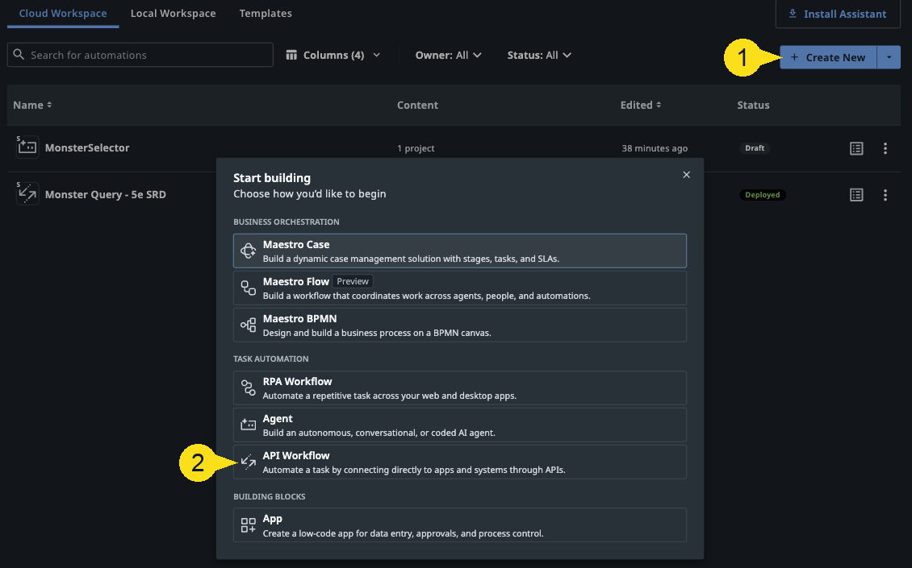
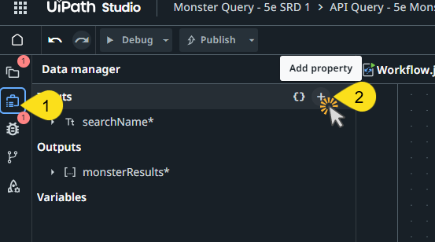
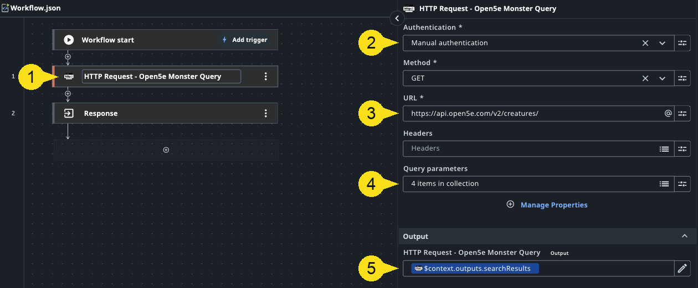
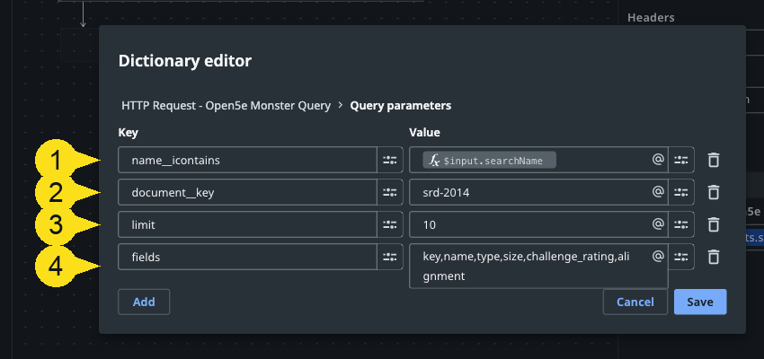
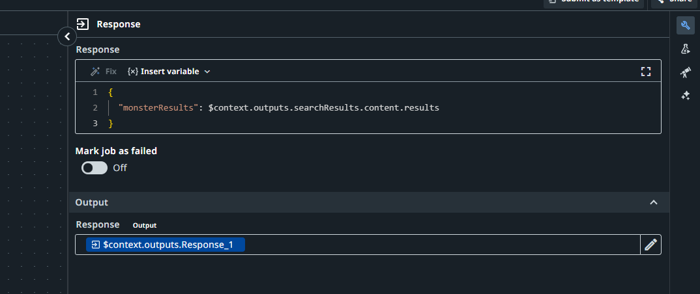
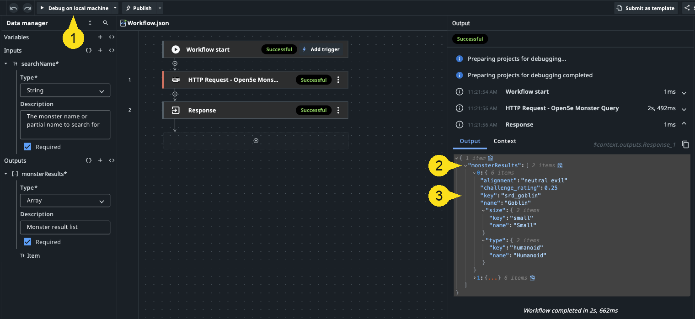
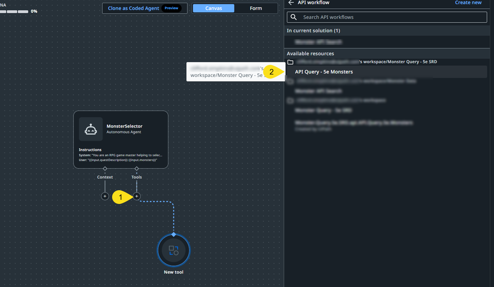
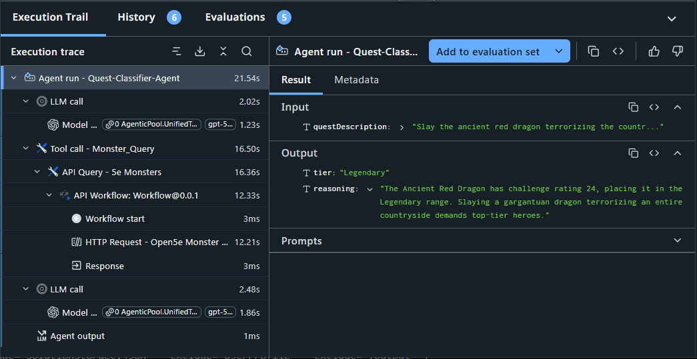
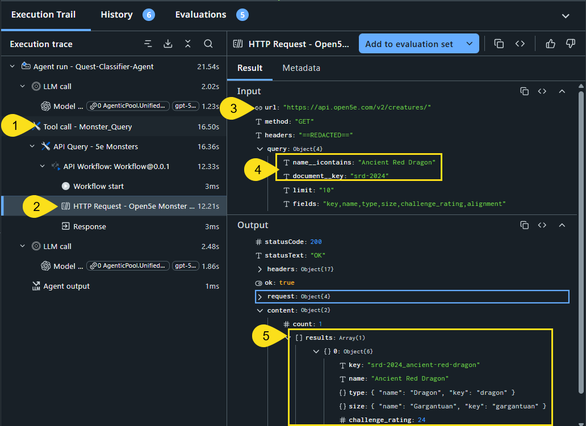

# Adding Tools to Your UiPath Agent

This lab extends the quest classifier you built in [Building a Low-Code Agent in Studio Web](../agents-lowcode/guide.md). That agent sorts a quest into one of four difficulty tiers, but its reasoning comes entirely from the model's training: ask it about an ancient red dragon and it answers Legendary because dragons are dangerous. In this lab, you give it a tool that looks the creature up in the 5e SRD (System Reference Document), so the tier rests on a real challenge rating that the agent cites in its reasoning.

The agent decides at runtime whether a quest needs a lookup at all. A quest that names a creature gets one; a quest to deliver a letter does not. That decision, and whether the agent makes it well, is what the evaluation at the end of this lab measures.

You will do the following:

1. Build a Monster Query API Workflow that searches the 5e SRD.
2. Connect it to your quest classifier as a tool.
3. Replace the system prompt so the agent knows when to call the tool and how to use what it returns.
4. Test the agent on quests that do and do not need a lookup.
5. Evaluate how the agent uses the tool with a tool-aware evaluation set.

**Estimated time:** 40-50 minutes

## What you are building

| Component | Details |
| --- | --- |
| **API Workflow** | Accepts `searchName` (string), calls the Open5e 5e SRD API, returns a `monsterResults` array |
| **Tool: Monster Query** | The API Workflow, connected to the agent. Called only when a quest names or strongly implies a specific creature |
| **Agent input: `questDescription`** | `string`; unchanged from the low-code lab |
| **Agent output: `tier`** | `string`; unchanged: exactly one of `Trivial`, `Standard`, `Heroic`, or `Legendary`. When the tool returns a challenge rating, the tier follows from it |
| **Agent output: `reasoning`** | `string`; unchanged, but now cites the challenge rating whenever the tool returned one |
| **Evaluation set** | A tool-aware set, scored by both a semantic similarity evaluator and a trajectory evaluator |

* * *

## Prerequisites

- **Studio Web** - runs in your browser; no desktop installation required. Open [Studio Web](https://cloud.uipath.com) in Chrome, Edge, or Firefox before starting.
- **UiPath account** - sign up or log in to [UiPath Automation Cloud](https://cloud.uipath.com) before starting.
- **A quest classifier agent in Studio Web** - this lab builds on the agent from [Building a Low-Code Agent in Studio Web](../agents-lowcode/guide.md), including its evaluation set. If you completed that lab, your agent is already in your workspace, and you need nothing else: the rest of this lab runs entirely in the browser.

### If you need the starter agent

If you did not complete the earlier lab, deploy the quest classifier starter instead. It includes the agent and the evaluation set from that lab. This path needs two local tools:

- **Node.js 18+** - required to install the UiPath CLI. Install from [nodejs.org](https://nodejs.org/) if needed.
- **UiPath CLI v1.198.0+** - check with `uip --version`; install or upgrade with `npm install -g @uipath/cli`.

<!-- test:prereq name="Node.js" version=">=18" ignore-for-docs="true" -->
```bash
node --version
```

<!-- test:prereq name="uip" version=">=1.1" ignore-for-docs="true" -->
```bash
uip --version
```

Then deploy the starter:

<!-- test:manual reason="requires git clone and uip login before starter upload" -->
```bash
git clone https://github.com/cliff-simpkins/UiPath-Workshops.git
cd UiPath-Workshops/starters/advguild.quest-classifier
uip login
uip solution upload .
```

Open [Studio Web](https://cloud.uipath.com) and confirm **AdvGuild.quest-classifier** appears in your workspace before beginning Step 1.

# Build the API workflow

## Step 1 - Build the Monster Query API workflow

An API Workflow is a lightweight workflow published as an API endpoint. You build one that wraps the [Open5e](https://open5e.com/) 5e SRD monster search: one input, one HTTP request, one output. Once published, it appears in the agent builder as a tool your agent can call.

This step has six sub-steps; budget 10–15 minutes to complete it.

### Create a new API workflow project

Select **Create New** from your Cloud Workspace. In the **Start building** dialog, choose **API Workflow** under **Task automation**.

Selecting the type creates the project immediately, with no name prompt, so you rename it in the next step.



Rename the solution and the default workflow. Open the context menu for each name in the project explorer and select **Rename**:

- **Solution name:** `Monster Query - 5e SRD`
- **Workflow name:** `API Query - 5e Monsters`

### Configure inputs and outputs

Select the **Data Manager** (clipboard icon along the left rail) to access the data variables for the workflow.



Add one input argument to the workflow:

| Name | Type | Required | Description |
| --- | --- | --- | --- |
| `searchName` | String | Yes | The monster name or partial name to search for |

Add one output argument:

| Name | Type | Required | Description |
| --- | --- | --- | --- |
| `monsterResults` | Array | Yes | Monster result list |

### Add the HTTP request

1. In the workflow canvas, select **+** between activities to open the activity menu. Select **HTTP**. The activity appears on the canvas as **HTTP Request**.
2. Open the activity context menu and select **Rename**. Name it `HTTP Request - Open5e Monster Query`.
3. In the **Properties** pane, confirm **Authentication** is **Manual authentication** and **Method** is **GET**. Both are the defaults on a new activity, so there is normally nothing to change.
4. Set **URL** to `https://api.open5e.com/v2/creatures/`.
5. Rename the activity output to `searchResults`.



**Set the Query parameters property:**

Open the **Query parameters** property, which opens a **Dictionary editor** with Key and Value columns, and add the following fields:

| Key | Value |
| --- | --- |
| `name__icontains` | the `searchName` input argument - see the warning below |
| `document__key` | `srd-2024` |
| `limit` | `10` |
| `fields` | `key,name,type,size,challenge_rating,alignment` |

> **Warning: `name__icontains` takes the `searchName` variable, and you must pick it from the variable picker rather than type it.** In the value field, type `@` to open the picker and select **searchName**. The field then renders the value as a chip, and the stored value is `$input.searchName`.
>
> Typing `@searchName` as plain text does **not** resolve to the variable. It is sent to the API as the literal string `@searchName`, which returns HTTP 200 with zero results while every node on the canvas stays green. If your workflow succeeds but finds no monsters, check this field first and confirm it renders as a chip.

What each parameter does:

- `name__icontains`: case-insensitive partial match; `dragon` returns "Adult Red Dragon", "Young Blue Dragon", and others
- `document__key: srd-2024`: filters to the official 5e SRD (the 2024 edition); without it, results include every publisher in the database, third-party content included
- `limit: 10`: caps candidates at 10; enough for the agent to reason over without flooding its context
- `fields`: limits the response to only the fields the agent needs; the full v2 creature object is much larger and would waste token budget

> **Warning: Open5e ignores query parameters it does not recognize, and returns HTTP 200 anyway.** Misspell `document__key`, or use the v1 spelling `document__slug`, and the filter is silently dropped: the call succeeds, the run is green, and the agent receives creatures from every publisher instead of the SRD. A `goblin` search returns 5 results with the filter applied and 29 without it, so check that the result count looks like a handful rather than a catalogue.



### HTTP Request property reference

The activity exposes the standard HTTP building blocks. Most you will configure for every API you call; some you will skip for public APIs like this one:

- **Authentication**: pre-built options for OAuth 2.0, API key, and Basic auth. Set to "Manual authentication" here because Open5e requires none. For authenticated APIs, choose the appropriate option and supply credentials.
- **Headers**: key/value pairs sent with every request. Common uses: `Authorization: Bearer <token>` for token-based APIs, `Accept: application/json` to control response format, and API versioning headers.
- **Body**: used with POST, PUT, and PATCH requests to send JSON, form data, or raw content. Not applicable for GET requests, which carry parameters in the URL via query parameters.
- **Query parameters**: key/value pairs appended to the URL. To reference a workflow argument, type `@` to open the variable picker and select the argument - the field stores `$input.<name>` and displays it as a chip. `@` is the picker's trigger character, not a reference syntax you can type out. See [configuring activities](https://docs.uipath.com/studio-web/automation-cloud/latest/user-guide/configuring-activities) for more on variables and expressions in Studio Web.
- **Output (renamed to `searchResults`)**: receives the full HTTP response including status code, headers, and body. Renaming from the default keeps the Response expression readable.

### Add the response

1. In the workflow canvas, select **+** after the HTTP Request and select **Response**.

   The Response activity defines what the API Workflow returns to its caller (in this case, what the agent's tool receives when it invokes the workflow). Whatever you put in the response body here becomes the tool output the agent reasons over.

2. Set the response body to:

   ```json
   {
     "monsterResults": $context.outputs.searchResults.content.results
   }
   ```

`$context.outputs` contains every named output from the activities in this workflow. `searchResults` is the output variable you renamed on the HTTP Request activity; `.content.results` navigates into the response envelope that Open5e wraps its data in, down to the actual array of monster entries. For more information, check out [the UiPath documentation on using Javascript to access workflow data](https://docs.uipath.com/studio-web/automation-cloud/latest/user-guide/managing-api-workflows#accessing-data-using-javascript).



### Test the workflow

1. Select **Debug** from the toolbar.
2. In the input panel, set `searchName` to `dragon` or `goblin` and run the workflow.
3. Verify the response includes a `monsterResults` array with monster entries before continuing.

A successful response contains up to 10 entries, each with `key`, `name`, `alignment`, and `challenge_rating`, plus nested `type` and `size` objects. Searching `goblin` returns five goblin and hobgoblin variants, such as Goblin Warrior (`srd-2024_goblin-warrior`, challenge rating 0.25) and Hobgoblin Captain. If you see an empty array, try a different search term; not every creature name has an exact match in the SRD.

For a quick check that every query parameter took effect, search `rat`. You should get exactly seven results, all with `srd-2024_` keys, including a Triceratops and two pirates: `name__icontains` matches the search text anywhere in the name. Any other count means a parameter is misspelled or not bound to the variable.



### Publish to your feed

Publishing registers the workflow as a deployable process in Orchestrator. This is what makes it discoverable in the agent builder's **Available resources** list: the builder surfaces published workflows from your workspace, not drafts saved locally in Studio Web.

1. Select **Publish** from the toolbar.
2. In the publish dialog, select **For me** to publish to your personal workspace feed. A personal workspace feed is a private package repository tied to your Orchestrator workspace; publishing "For me" makes this workflow visible only to you, which is the right scope for development and testing. See [Personal Workspaces](https://docs.uipath.com/orchestrator/automation-cloud/latest/user-guide/personal-workspaces) in the UiPath docs for details.
3. Select **Publish** to confirm.

> **Workflow not appearing in Available resources in Step 3?** The workflow must be published (not just saved) before it is visible as a tool. If it does not appear, return here and confirm the publish completed successfully, then refresh the agent builder.

* * *

With the workflow published, it is available in the agent builder as a connectable tool in the next section.

# Connect to your agent

## Step 2 - Open the quest classifier

In Studio Web, open your quest classifier solution in the agent builder: either the one you built in the low-code lab, or **AdvGuild.quest-classifier** if you deployed the starter.

Take a moment to orient on its current state before making changes:

- **Input:** `questDescription` (string).
- **Outputs:** `tier` (string, one of four values) and `reasoning` (string).
- **System prompt:** describes the four tiers. If Autopilot wrote it, it most likely also tells the agent to classify from the description alone and not to use tools.
- **Evaluation set:** the five cases from the low-code lab. You rerun them in Step 6.

In this lab, you do not change the input or the outputs. You add a tool, and you replace the system prompt so the agent knows how to use it.

* * *

## Step 3 - Connect the API workflow as a tool

### Add the tool

Make sure you are on the **Canvas** view: use the **Canvas / Form** toggle at the top of the agent builder. The **+** button under Tools is only visible in Canvas view.

1. On the agent canvas, select **+** under **Tools**.
2. In the **Choose tool** panel, select **API workflow** under **Toolbox**.
3. Under **Available resources**, select the workflow you created in Step 1.

   Your workflow is listed by its **project** name, nested under a `<workspace>/<solution>` folder line - so if you renamed the solution in Step 1, look for `API Query - 5e Monsters`, not the solution name. You can also filter with the **Search API workflows** box above the list.

> **Available resources empty, or showing "No tools found"?** The workflow must be published before it appears here. Return to Step 1 and complete the **Publish to your feed** sub-step, then come back and try again.



### Configure the tool description

Give the tool a name and description. The description is what the agent reads at runtime to decide when and how to call the tool; write it as an instruction to the agent, not a label for humans:

- **Name:** `Monster Query`
- **Description:** `Searches the 5e SRD for monsters whose name contains the search text. Search with the most specific creature name the quest gives; a general term such as a creature type can return many matches and miss the one you need. Returns up to 10 candidates with key, name, type, size, challenge rating, and alignment. Call this tool when a quest names or strongly implies a specific creature, to look up its challenge rating.`

> **The description drives tool selection.** The agent reads this description, not the tool name, to decide when and how to call the tool. A vague description produces vague tool use.

The "most specific creature name" instruction earns its place. A search for `dragon` matches 43 creatures, and the 10 that come back are all adult dragons, so a quest about an ancient red dragon never sees the right candidate. A search for `ancient red dragon` returns exactly one result. The description is where you teach the agent how the API behaves.

> **An API workflow is one kind of tool.** An agent can also call RPA workflows, Integration Service connectors (for Slack, Outlook, or an ERP system), document understanding, Maestro cases and flows, DeepRAG, MCP servers, and other agents. The steps to connect and describe the tool are the same.

* * *

## Step 4 - Replace the system prompt

The current system prompt was written for an agent with no tools. Replace it in full rather than adding to it: if it tells the agent not to use tools, as an Autopilot prompt usually does, an appended instruction to call Monster Query contradicts it, and the agent may never make the call.

To open the **Properties** panel, select the agent on the canvas or select the wrench icon in the upper-right corner. Replace the system prompt with:

<!-- test:manual reason="system prompt replacement in Agent Canvas Properties panel" -->
```text
You are a quest intake classifier for an adventurer's guild in a fantasy RPG world.

Classify the incoming quest description into exactly one difficulty tier:
- Trivial: simple errands anyone can handle (for example, deliver a letter, clear rats from a cellar)
- Standard: moderate quests requiring some adventuring skill (for example, escort a merchant caravan, hunt a wyvern)
- Heroic: difficult quests requiring significant adventuring expertise (for example, slay an adult dragon, infiltrate a thieves' guild)
- Legendary: extreme quests requiring top-tier heroes to complete (for example, defeat a lich, slay an ancient dragon)

Using the Monster Query tool:
- Call Monster Query when the quest description names or strongly implies a specific creature the adventurers must face.
- Search with the most specific creature name the quest gives.
- Only search for creatures in the quest itself, never for a creature you are using as a comparison or reference point.
- If a search returns no results, you may try one shorter or more general name. Stop after three searches in total.
- If the tool returns more than one result, pick the best fit: name match first, then number (a group of rats fits "Swarm of Rats" better than "Rat"), then type.

Using the challenge rating:
- When the tool returns a challenge_rating, set the tier from this map: Trivial 0-5, Standard 6-12, Heroic 13-20, Legendary 21 and above.
- Cite the exact challenge rating in your reasoning.
- Never guess or invent a challenge rating. Only cite one the tool actually returned.
- If you do not call the tool, or it returns nothing that fits, classify from the quest description alone.

Return the tier and a brief, two-sentence reasoning.
```

The challenge rating map is what turns a lookup into a tier. Swarm of Rats (challenge rating 0.25) lands in Trivial, Wyvern (6) in Standard, Adult Red Dragon (17) in Heroic, and Ancient Red Dragon (24) in Legendary.

> **Keep the examples consistent with the map.** The tier examples and the map are two sources of truth, so they must agree. "Drive back the kobolds" is a tempting Standard example, but kobolds are challenge rating 0.125, which the map puts in Trivial, and a contradiction like that makes the agent's tier unpredictable.

The input and output schemas do not change. The challenge rating goes into the `reasoning` text, not a new field.

> **Agents are non-deterministic.** Your agent's search terms and reasoning will vary from run to run. What matters is that it calls the tool when a quest names a creature, skips it when one does not, and cites only challenge ratings the tool returned.

* * *

With the tool connected and the system prompt replaced, you are ready to test the agent in the next section.

# Test end-to-end

## Step 5 - Test end-to-end

Select **Debug** from the toolbar at the top of the agent builder, enter the following quest, and select **Save & Debug**:

<!-- test:manual reason="debug test case in Studio Web" -->
```text
Slay the ancient red dragon terrorizing the countryside.
```

Watch the **Execution Trail** at the bottom of the agent builder. For this quest, expect:

1. The agent calls **Monster Query** with a search term for the ancient red dragon.
2. The tool returns one result: Ancient Red Dragon (`srd-2024_ancient-red-dragon`), challenge rating 24.
3. The agent returns a `tier` of `Legendary`, and its `reasoning` cites the challenge rating of 24.



Select the **HTTP Request - Open5e Monster Query** span to see the request the tool actually sent: the `v2/creatures/` URL, the search term the agent chose in `name__icontains`, and the `document__key` and `fields` values you configured in Step 1.



Compare this run with the same quest in the low-code lab. The tier is the same, but the reasoning now rests on a number from the SRD instead of on the model's sense that dragons are dangerous.

Now run two more quests, letting each finish before you start the next:

<!-- test:manual reason="debug test case in Studio Web" -->
```text
Clear the rats out of the inn cellar. They are loud and they are eating all of the cheese.
```

Expected: one Monster Query call for rats, Swarm of Rats (challenge rating 0.25), tier `Trivial`.

<!-- test:manual reason="debug test case in Studio Web" -->
```text
Deliver a sealed letter to the magistrate in the next town.
```

Expected: **no** Monster Query call, because the quest names no creature, and tier `Trivial`.


The letter run matters as much as the dragon run. An agent that calls the tool on every quest wastes an API call and tokens each time, and an agent that never calls it is back to guessing. Step 7 measures both.

* * *

With the agent calling its tool only when it should, you are ready to evaluate it in the next section.

# Evaluate the agent

## Step 6 - Rerun your existing evaluation set

Your agent already has an evaluation set: the five cases from the low-code lab. Before you build anything new, rerun it. This is what an evaluation set is for: checking what a change did to behavior you had already accepted.

1. Open the solution's **Evaluation Sets** node in the project explorer, and open the set from the low-code lab.
2. Select **Run**.
3. When the run finishes, select **View all results**, then select the most recent run.

<!-- test:manual reason="evaluation run in Studio Web" -->

<!-- screenshot: agents-tools-step-06a.png - Results of the low-code evaluation set rerun after adding the tool, with lower scores on the rats and dragon cases -->

Expect the tiers to hold, and expect the scores on the rats and dragon cases to drop. Their saved outputs come from the agent before it had a tool, so their reasoning does not cite a challenge rating, and the new reasoning does. The semantic similarity evaluator notices the difference in meaning.

That drop is not a bug to fix. It is the evaluation set doing its job: it shows you exactly which cases a change affected. Here the change is the one you wanted, so the next step builds a set that describes the new behavior.

> **Evaluation scores are non-deterministic.** The evaluator is itself a language model, so scores move by a few points between runs. Look for which cases moved, not for small differences.

* * *

## Step 7 - Build a tool-aware evaluation set

The new set checks two things: what the agent answered, and how it got there.

- **Semantic similarity** - compares the agent's output to the expected output by meaning, not exact wording.
- **Trajectory** - judges how the agent reached its answer: whether it called the tool, what it searched for, and whether it used only challenge ratings the tool returned. This is the score that tells you whether the tool description and system prompt are doing their job.

### Capture the remaining runs

You already have three runs from Step 5. In the **Debug** panel, run the agent on two more quests:

<!-- test:manual reason="additional debug test cases in Studio Web" -->
```text
Escort a merchant caravan through the hill country to the coast.
```

<!-- test:manual reason="additional debug test cases in Studio Web" -->
```text
Recover a stolen relic from a noble's estate. The guards are many, the owner is powerful, and nobody who has tried has come back.
```

Neither quest names a creature, so neither should call Monster Query. The relic quest is the harder test: the guards and the powerful owner are people, not monsters, and an agent that over-uses its tool may still search for something.

### Create the set and add the runs

1. In **Evaluation Sets**, create a new evaluation set and name it `Quest Classifier with Tools`.
2. In the **Execution Trail** for your most recent run, select **Add to evaluation set** and choose the new set.
3. Open the **History** tab in the bottom panel. For each of the other four runs from Steps 5 and 7, select the beaker icon and add it to the same set.

> **Warning: Save only runs you agree with.** The evaluation set treats each saved output as the correct answer. Check that every run reached the expected tier and called the tool only when it should have.

<!-- screenshot: agents-tools-step-07a.png - New evaluation set with the five runs added -->

### Describe the expected behavior

The trajectory evaluator scores each run against a written description of what the agent should do. Open the new set, select **Edit** on each case, rename it, paste its expected behavior into the expected behavior field, and select **Save**:

| Name | Expected behavior |
| --- | --- |
| `legendary-ancient-dragon` | Calls Monster Query once before answering, searching for the ancient red dragon rather than for dragons in general. Cites its challenge rating of 24. |
| `trivial-rats` | Calls Monster Query once before answering, with a search term for rats. Selects Swarm of Rats and cites its challenge rating of 0.25. |
| `trivial-letter` | Does not call Monster Query, since no creature is named. Classifies from the description alone. |
| `standard-caravan` | Does not call Monster Query, since no creature is named. Classifies from the description alone. |
| `no-creature-relic` | Does not call Monster Query, since the quest names no creature; guards and a noble are people, not monsters. Classifies from the description alone as Standard or Heroic. |

Leave Monster Query set to make real calls, not simulated ones; the trajectory evaluator is less useful when tool calls are mocked.

<!-- test:manual reason="evaluation set editing in Studio Web" -->

### Attach both evaluators and run the set

1. In the new set, select the pencil icon next to **Applied Evaluators**. Make sure both a semantic similarity evaluator and a trajectory evaluator are listed. If the project has no trajectory evaluator yet, create one from the same dialog.
2. Select **Run**.
3. When the run finishes, select **View all results**, then select the most recent run. Each case shows a semantic similarity score and a trajectory score, from 0 to 100.
4. Select any case to see the run, its scores, and each evaluator's explanation.

<!-- test:manual reason="evaluation run in Studio Web" -->

<!-- screenshot: agents-tools-step-07b.png - Results with semantic similarity and trajectory scores for the five cases -->

> **Warning: A missing evaluator fails silently.** If you forget to attach the trajectory evaluator, the set still runs and shows only semantic similarity scores. If you see one score per case, revisit **Applied Evaluators**.

A low trajectory score with a high semantic similarity score is the most useful result here: the agent reached a reasonable answer, but not the way you asked. Typical causes are a search term that is too general (the `dragon` problem from Step 3), a tool call on a quest that names no creature, or a challenge rating cited from memory. Fix the tool description or the system prompt, rerun the set, and compare. From here on, rerun both sets after every prompt change.

* * *

## What you built

You extended a low-code agent with a live tool and measured how it uses it:

- Built a live API connector that searches the 5e SRD: one input, one HTTP request, one output.
- Connected it to your quest classifier as a tool, with a description that teaches the agent how to search.
- Replaced the system prompt so the agent calls the tool only when a quest names a creature, and sets the tier from the challenge rating it returns.
- Used your existing evaluation set to see what the change did, then built a tool-aware set scored by both semantic similarity and trajectory.

## What's next

- [Building a LangGraph agent](../agents-langgraph/guide.md) - build this same quest classifier, with the same SRD lookup tool, as a coded agent in Python.
- [Agent evaluations](https://docs.uipath.com/agents/automation-cloud/latest/user-guide/agent-evaluations) - reference for evaluation sets, evaluator types, and simulated tool calls.
- [Open5e API docs](https://open5e.com/api-docs) - explore the full monster search API and the other fields it can return.
- [UiPath Community](https://community.uipath.com) - forums, how-tos, and developer discussion.
